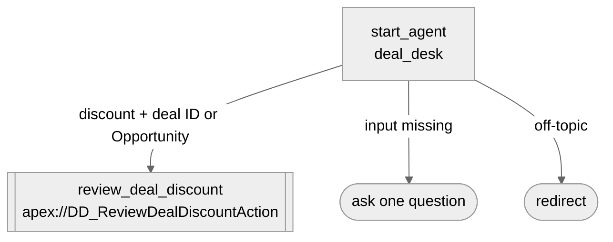

# Agent Spec: DD_Deal_Desk_Agent

## Purpose & Scope

Internal Agentforce employee agent for sales reps. It reviews a requested discount on a deal with the
MuleSoft Agent Fabric Deal Desk (pricing policy, customer credit, contract draft) and reports the
decision: Approved, VP Approval Required, Not Allowed, or Needs Info. When an Opportunity is given,
the decision is saved on that Opportunity. Nothing else is in scope.

## Behavioral Intent

- The agent needs a **discount percent** and either a **Deal Desk deal ID** (for example `ACME-Q4`)
  or an **Opportunity Id** before calling the action. If one is missing, it asks one short question.
- Single action implemented in invocable Apex (`DD_ReviewDealDiscountAction`, already deployed and tested).
- The agent reports the decision exactly as returned. It never invents approval, margin, credit,
  or contract details, and never says a deal is approved unless the decision is Approved.
- VP Approval Required: tell the rep that VP approval is needed and give the contract draft ID. The
  agent cannot request VP approval itself.
- Not Allowed: give the reason and the suggested maximum discount from the summary.
- Errors: show the error message in plain words. For `OPPORTUNITY_NOT_ACCESSIBLE`, tell the rep to ask
  the admin for the `DD_Deal_Desk_User` permission set (or to check the Opportunity is shared with them).
- Off-topic requests: redirect briefly to deal discount reviews.
- No deterministic runtime logic consumes any stored value, so no variables are needed.
  Deal ID, discount and Opportunity stay in conversation history.

## Subagent Posture

| Subagent | Posture | Why this posture? | Deterministic controls |
|----------|---------|-------------------|------------------------|
| start_agent `deal_desk` | agentic | One focused objective, one action, the model judges when inputs are complete | none |

## Subagent Map

## Variables

None.

## Actions

### review_deal_discount (start_agent deal_desk)

- **Target:** `apex://DD_ReviewDealDiscountAction`
- **Status:** EXISTS (deployed to ProductPillarSDO1, 20/20 tests passing)
- **Side effect:** HTTP callout to the Agent Fabric broker. When `opportunityId` is given, it updates
  `DD_Decision__c`, `DD_Requested_Discount__c`, `DD_Contract_Draft_Id__c` and `DD_Deal_Desk_Summary__c`
  on that Opportunity, running as the user (USER_MODE).

#### Inputs (names match the Apex `@InvocableVariable` fields)

| Name | Type | Required | Source |
|------|------|----------|--------|
| opportunityId | object, `complex_data_type_name: lightning__recordIdType` (Apex `Id`; `string` fails live-preview validation) | No | User input |
| dealId | string | No | User input, for example `ACME-Q4` |
| discountPercent | number (Apex `Decimal`) | Yes | User input, 20 means 20% |

#### Outputs

| Name | Type | Visible to User? | Notes |
|------|------|------------------|-------|
| isSuccess | boolean | No | Internal success flag |
| decision | string | Yes | Approved / VP Approval Required / Not Allowed / Needs Info |
| contractDraftId | string | Yes | Empty when not allowed |
| summary | string | Yes | Margin, credit report (PAN masked), contract terms |
| errorMessage | string | Yes | What went wrong, or a note that the decision was not saved |
| errorType | string | No | Error category, used by the model to choose its reply |

## Action Invocation Strategy

| Action | Subagent | Invocation Mode | Why |
|--------|----------|-----------------|-----|
| review_deal_discount | deal_desk | Planner slot-fill | The rep starts the review; the model decides when the inputs are complete |

## Deterministic Controls

None. No regulation, authorization or ordering requirement needs a runtime gate. Access is
enforced by the Apex action (USER_MODE + `DD_Deal_Desk_User` permission set).

## Architecture Pattern

One `start_agent deal_desk` execution block, zero `subagent` blocks, no router.

## Agent Configuration

- **developer_name:** `DD_Deal_Desk_Agent`
- **agent_label:** `Deal Desk Agent`
- **agent_type:** `AgentforceEmployeeAgent`. Internal sales reps use it; it is not customer-facing.
- **access.default_agent_user:** N/A (employee agent, must be omitted)
- **Target org:** ProductPillarSDO1 (PSP org)
- **Permissions:** reps need the `DD_Deal_Desk_User` permission set (already deployed). Assign it to each
  rep who uses the agent.
- **Release:** stays in draft (deploy + preview). Publish/activate only after explicit approval.
