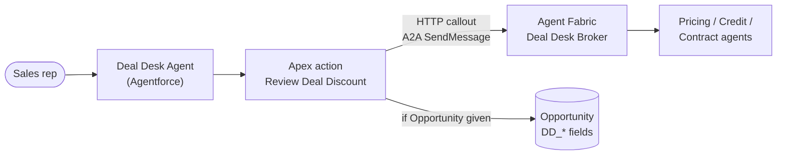

# deal-desk-salesforce

The Salesforce part of the **Deal Desk** demo. A sales rep asks the **Deal Desk Agent** (Agentforce) whether a discount is allowed. The agent calls the MuleSoft Agent Fabric Deal Desk broker. When the rep names an Opportunity, the decision is saved on it.



| Repo | Layer |
|---|---|
| **deal-desk-salesforce** (this repo) | Agentforce agent, Apex, the Deal Desk app and fields |
| [deal-desk-network](https://github.com/deepshikhalmp-dot/deal-desk-network) | Agent Fabric network and broker |
| [deal-desk-agents](https://github.com/deepshikhalmp-dot/deal-desk-agents) | The Pricing, Credit and Contract mock agents |

## Decisions

| Requested discount | Decision | Contract draft |
|---|---|---|
| Up to 15% | **Approved** | Yes, for example `CTR-ACME-Q4-10` |
| Over 15%, up to 25% | **VP Approval Required** | Yes, pending VP approval |
| Over 25% | **Not Allowed** | No |
| Deal or discount missing | **Needs Info** | No |

Demo deal IDs: `ACME-Q4` and `GLOBEX-Q4`.

## What's in here

All metadata is under `force-app/main/default/`.

| Component | API name | Purpose |
|---|---|---|
| Agentforce employee agent | `DD_Deal_Desk_Agent` (`aiAuthoringBundles/`) | Agent Script agent with one action. It asks for missing inputs, reports the decision as returned and redirects off-topic requests. The design is in [`DD_Deal_Desk_Agent-AgentSpec.md`](DD_Deal_Desk_Agent-AgentSpec.md) |
| Invocable Apex | `DD_ReviewDealDiscountAction` | "Review Deal Discount" action. Inputs: discount %, plus a deal ID or an Opportunity Id. It saves the result on the Opportunity in **user mode** and returns a clear error when the user lacks access |
| Apex service | `DD_DealDeskBrokerService` | Builds the A2A JSON-RPC `SendMessage` call to the broker and parses `DEAL DESK DECISION: …` and the `CTR-…` contract ID |
| Apex tests | `DD_ReviewDealDiscountActionTest`, `DD_DealDeskBrokerServiceTest`, `DD_DealDeskBrokerMock`, `DD_TestDataFactory` | 20 tests with an HTTP callout mock. They run as a test user, with and without the permission set |
| Opportunity fields | `DD_Deal_ID__c`, `DD_Requested_Discount__c`, `DD_Decision__c`, `DD_Contract_Draft_Id__c`, `DD_Deal_Desk_Summary__c` | The deal mapping and the saved decision |
| Lightning app | `DD_Deal_Desk` | "Deal Desk" app: Home, Opportunities, Accounts, Contacts, Reports, Dashboards |
| Record page | `DD_Deal_Desk_Opportunity_Record_Page` | Opportunity page in the app that shows the Deal Desk fields |
| List views | `DD_All_Deal_Desk_Deals`, `DD_Awaiting_Review`, `DD_Approved`, `DD_VP_Approval_Required`, `DD_Not_Allowed` | Opportunity views by decision |
| Permission set | `DD_Deal_Desk_User` | Gives reps the app, the agent, the Apex class, Opportunity read/edit and access to the DD fields |
| Remote site | `DD_Agent_Fabric_Broker` | Allows the callout to the Agent Fabric gateway |
| Published agent metadata | `bots/`, `genAiPlannerBundles/` | Pulled back into the project by `sf agent publish`. **Do not deploy these by hand** |

## Setup

Requirements: Salesforce CLI (`sf`), an org with Agentforce enabled, and API version 66.0.

```bash
# 1. Deploy the metadata (not the published agent artifacts)
sf project deploy start --target-org <alias> \
  --source-dir force-app/main/default/classes \
  --source-dir force-app/main/default/objects \
  --source-dir force-app/main/default/remoteSiteSettings \
  --source-dir force-app/main/default/applications \
  --source-dir force-app/main/default/flexipages \
  --source-dir force-app/main/default/aiAuthoringBundles

# 2. Run the tests
sf apex run test --target-org <alias> --class-names DD_ReviewDealDiscountActionTest \
  --class-names DD_DealDeskBrokerServiceTest --code-coverage --wait 10

# 3. Publish and activate the agent
sf agent publish authoring-bundle --api-name DD_Deal_Desk_Agent --target-org <alias>
sf agent activate --api-name DD_Deal_Desk_Agent --target-org <alias>

# 4. Deploy the permission set (it references the agent) and assign it to each rep
sf project deploy start --target-org <alias> --source-dir force-app/main/default/permissionsets
sf org assign permset --name DD_Deal_Desk_User --target-org <alias> --on-behalf-of <rep username>
```

The broker URL is set in `DD_DealDeskBrokerService.BROKER_ENDPOINT` and in the remote site setting. Point both at your own Agent Fabric gateway if you deploy the [network](https://github.com/deepshikhalmp-dot/deal-desk-network) yourself.

## Try it

1. Open the **Deal Desk** app and click the Agentforce button in the header.
2. Ask: *"Can ACME-Q4 get 10% discount?"* The agent replies **Approved** with contract draft `CTR-ACME-Q4-10`.
3. Open an Opportunity whose **Deal Desk Deal ID** is `ACME-Q4`, and ask for 20% on that Opportunity. The agent replies **VP Approval Required**, and the decision, discount, contract draft and summary are saved on the record. The record then shows up in the *VP Approval Required* list view.
4. Ask for 30% on `GLOBEX-Q4`. The agent replies **Not Allowed**, maximum 25%.

The broker call takes a few seconds while the agent shows "Checking with the Deal Desk...". The first call after the Render service has been idle can take up to a minute.
