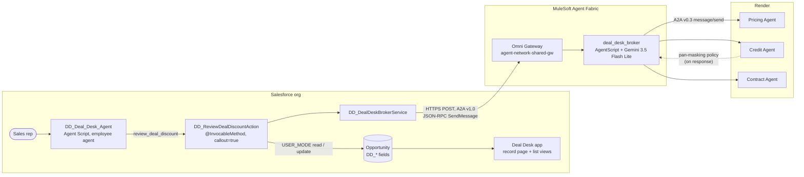
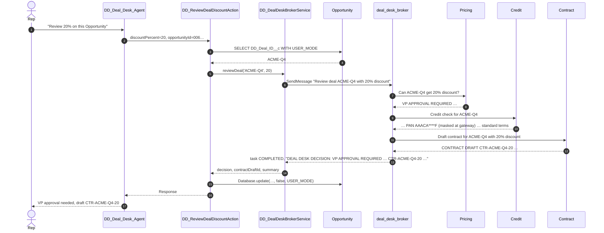

# Deal Desk: Technical Design

| | |
|---|---|
| **Status** | Built and live in the demo org (`ProductPillarSDO1`). Agent v1 is published and active |
| **Audience** | Developers who maintain or extend the Deal Desk demo |
| **Repos** | [deal-desk-salesforce](https://github.com/deepshikhalmp-dot/deal-desk-salesforce) · [deal-desk-network](https://github.com/deepshikhalmp-dot/deal-desk-network) · [deal-desk-agents](https://github.com/deepshikhalmp-dot/deal-desk-agents) |
| **Setup** | [SETUP.md](../SETUP.md) |

---

## 1. Purpose and scope

A sales rep asks an Agentforce agent whether a discount on a deal is allowed. The decision is not made in Salesforce. It comes from a **MuleSoft Agent Fabric** broker, which coordinates three back-office agents (Pricing, Credit, Contract) over the A2A protocol. When the rep names an Opportunity, Salesforce stores the decision on it so that it shows up on the record page and in list views.

The demo shows four things:
- An Agentforce agent calling an external multi-agent network through one Apex action.
- Agent Fabric orchestration with an LLM, where the decision itself is routed deterministically.
- Governance at the gateway: PAN numbers are masked before the LLM sees them.
- Writing the result back to Salesforce in user mode.

**In scope:** the discount review, the decision write-back and the Deal Desk app.

**Out of scope:**
- Real approval routing. The agent tells the rep that VP approval is needed but does not submit anything.
- Real ERP, CRM or CLM integration. The three agents are mocks.
- Production-grade authentication. See [§10](#10-known-limitations-and-future-work).

## 2. Architecture



| Layer | Technology | Repo |
|---|---|---|
| Conversation | Agentforce employee agent written in Agent Script (`AiAuthoringBundle`) | deal-desk-salesforce |
| Integration | Apex invocable action + HTTP callout service | deal-desk-salesforce |
| Data and UI | Opportunity custom fields, Lightning app, FlexiPage, list views, permission set | deal-desk-salesforce |
| Orchestration | Agent Fabric agent network 2.0.0; AgentScript broker (`AGENTFABRIC=1.5`); Gemini LLM | deal-desk-network |
| Governance | DataWeave body-transformation policy on the Credit connection | deal-desk-network |
| Back office (mock) | Node.js 20 + Express 5; three A2A v0.3 agents on one server | deal-desk-agents |

## 3. End-to-end flow



When the rep gives only a deal ID and no Opportunity, the flow skips the Opportunity read (step 3) and the save (step 16). Nothing is written to Salesforce in that case.

## 4. Business rules

The rules live in `deal-desk-agents/data.js` and are applied by the mock agents. Salesforce and the broker contain **no** thresholds.

| Requested discount | Pricing decision | Contract |
|---|---|---|
| ≤ 15% | `APPROVED` | Standard template |
| > 15% and ≤ 25% | `VP APPROVAL REQUIRED` | Extended (3-year) template |
| > 25% | `NOT ALLOWED` | Not drafted |

Two more rules apply:
- **Credit.** If the customer's risk is `HIGH` or the deal amount is above the credit limit, the Credit Agent recommends secured terms. The Contract Agent then uses the **secured** template (50% advance payment), whatever the discount.
- **Margin.** Margin after the discount is reported but never changes the decision.

| Demo deal | Customer | Amount | Margin | Credit |
|---|---|---|---|---|
| `ACME-Q4` | Acme Retail | ₹50,00,000 | 35% | LOW, limit ₹80,00,000 |
| `GLOBEX-Q4` | Globex Corp | ₹20,00,000 | 22% | HIGH, limit ₹10,00,000 |

## 5. Salesforce components

### 5.1 Agent: `DD_Deal_Desk_Agent`

Source: `force-app/main/default/aiAuthoringBundles/DD_Deal_Desk_Agent/DD_Deal_Desk_Agent.agent`. The full design is in the [Agent Spec](../DD_Deal_Desk_Agent-AgentSpec.md).

- **Type:** `AgentforceEmployeeAgent`. It is used inside Lightning Experience and has no default agent user and no messaging variables.
- **Structure:** one `start_agent deal_desk` block with one action, `review_deal_discount` → `apex://DD_ReviewDealDiscountAction`. There are no subagents and no variables, because the inputs stay in the conversation.
- **Behaviour:**
  - Asks one question when the discount or the deal reference is missing.
  - Reports the decision exactly as returned, and never says "approved" unless the decision is Approved.
  - Maps access errors to "ask your admin for `DD_Deal_Desk_User`".
  - Redirects off-topic requests.
- **Action inputs:**
  - `discountPercent`: number, required.
  - `dealId`: string.
  - `opportunityId`: `object` with `complex_data_type_name: "lightning__recordIdType"`.

  > An Apex `Id` input must be typed this way. A `string` passes the local compile, `sf agent validate` and simulated preview, but fails live preview.
- **Action outputs:**
  - Shown to the rep: `decision`, `contractDraftId`, `summary`, `errorMessage`.
  - Hidden from the model's reply (`filter_from_agent: True`) but used for reasoning: `isSuccess`, `errorType`.
- **Progress message:** "Checking with the Deal Desk..."
- `bots/` and `genAiPlannerBundles/` are produced by `sf agent publish`. They are committed for reference but are never deployed by hand.

### 5.2 `DD_ReviewDealDiscountAction` (invocable)

`@InvocableMethod(label='Review Deal Discount', category='Deal Desk', callout=true)`. The class is `with sharing`.

| Input | Type | Required | Notes |
|---|---|---|---|
| `opportunityId` | Id | No | Supplies `DD_Deal_ID__c` when `dealId` is blank; the decision is saved on it |
| `dealId` | String | No | Takes precedence over the Opportunity's Deal ID |
| `discountPercent` | Decimal | Yes | 20 means 20% |

| Output | Notes |
|---|---|
| `isSuccess` | True when the broker returned a decision (including Needs Info) |
| `decision` | `Approved`, `VP Approval Required`, `Not Allowed` or `Needs Info` |
| `contractDraftId` | `CTR-…`; empty for Not Allowed |
| `summary` | The broker's full reply text (credit report with the PAN masked) |
| `errorMessage` | The failure reason, or a note that the decision was not saved |
| `errorType` | See [§7](#7-error-handling) |

**Processing (bulk-safe):**
1. Collect all `opportunityId`s and read them in **one** `SELECT Id, DD_Deal_ID__c … WITH USER_MODE` query. A `QueryException` (missing FLS) is caught and turned into an access error instead of failing the whole batch.
2. For each request:
   1. Work out the deal ID from the input, or else from the Opportunity.
   2. Call the broker service.
   3. Map the result onto a `Response`.
3. Write back every successful Opportunity request in **one** `Database.update(list, false, AccessLevel.USER_MODE)`. Partial success is allowed, and a failed row only adds a note to its `errorMessage`. The decision is still returned.

> **Limit note:** each request makes one synchronous callout of up to 120 s. Agentforce sends one request per action call, so this is fine. A Flow that sends many requests in one transaction would hit the callout limits (100 callouts, 120 s each, total transaction time).

### 5.3 `DD_DealDeskBrokerService`

`with sharing`. It wraps the A2A call.

- **Endpoint:** the `BROKER_ENDPOINT` constant (`…/deal_desk_broker/`) plus remote site `DD_Agent_Fabric_Broker`.
- **Timeout:** 120,000 ms.
- **Request:** `POST`, `Content-Type: application/json`, `A2A-Version: 1.0`:
  ```json
  {"jsonrpc":"2.0","id":"<uuid>","method":"SendMessage",
   "params":{"message":{"messageId":"<uuid>","role":"ROLE_USER",
     "parts":[{"text":"Review deal ACME-Q4 with 20% discount"}]}}}
  ```
- **Response parsing:**
  1. Read the state from `result.task.status.state` and the text from `result.task.status.message.parts[0].text`.
  2. Map the state:

     | `state` | Result |
     |---|---|
     | `TASK_STATE_COMPLETED` | The decision comes from the text prefix `DEAL DESK DECISION: APPROVED / VP APPROVAL REQUIRED / NOT ALLOWED`. The contract ID is the first match of `CTR-[A-Z0-9-]+`, ignored for Not Allowed |
     | `TASK_STATE_INPUT_REQUIRED` | `Needs Info`, success |
     | anything else | Not successful; returns a "Gemini busy, wait ~60 s" retry message |

- **Exceptions:** `DealDeskBrokerException` is thrown in these cases:
  - Blank inputs.
  - A `CalloutException`.
  - A non-200 HTTP status.
  - Unparseable JSON.
  - A reply with no task status.

### 5.4 Data model: Opportunity fields

| Field | Type | Written by | Purpose |
|---|---|---|---|
| `DD_Deal_ID__c` | Text(20) | Admin / rep | Maps the Opportunity to a Deal Desk deal (`ACME-Q4`) |
| `DD_Requested_Discount__c` | Percent(5,2) | Action | Last requested discount |
| `DD_Decision__c` | Picklist (restricted): Approved, VP Approval Required, Not Allowed, Needs Info | Action | Last decision |
| `DD_Contract_Draft_Id__c` | Text(40) | Action | `CTR-…` draft from the Contract Agent |
| `DD_Deal_Desk_Summary__c` | Long Text Area(32768) | Action | Full broker reply |

Each review overwrites these fields with the latest result. There is no history object, so use field history tracking if an audit trail is needed.

### 5.5 UI

| Component | Details |
|---|---|
| App `DD_Deal_Desk` | Standard navigation, desktop. Tabs: Home, Opportunities, Accounts, Contacts, Reports, Dashboards. App-level `View` override for Opportunity → the record page below |
| FlexiPage `DD_Deal_Desk_Opportunity_Record_Page` | Highlights: Account, Amount, Stage, Close Date, Decision, Requested Discount. The details section shows all five DD fields |
| List views (Opportunity, scope Everything) | `DD_All_Deal_Desk_Deals`, `DD_Awaiting_Review` (Deal ID set AND no decision), `DD_Approved`, `DD_VP_Approval_Required`, `DD_Not_Allowed` |

## 6. Agent Fabric network (summary)

The full detail is in the [deal-desk-network README](https://github.com/deepshikhalmp-dot/deal-desk-network#readme).

**Orchestrator `dealReview`.** The LLM (Gemini 3.5 Flash Lite) finds the deal ID and discount, then calls the agents in this order, each at most once:
1. Pricing.
2. Credit. Its reply is copied word for word into `credit_report`.
3. Contract. This step is skipped when pricing returns Not Allowed.

The orchestrator returns structured outputs: `pricing_decision`, `credit_decision`, `contract_draft_id`, `credit_report` and `summary`. It runs at most 6 loops, with a 120 s task timeout.

**Router `decisionRouter`.** It picks the reply template from `pricing_decision`. The **decision wording is deterministic**: the LLM supplies only the enum value and the summary lines.

**Echo responses.** The reply is a `TASK_STATE_COMPLETED` status event whose text starts with `DEAL DESK DECISION: …`. Salesforce depends on this prefix and on the `CTR-` format.

**Policy `pan-masking`.** A DataWeave regex runs `\b([A-Z]{5})[0-9]{4}([A-Z])\b → $1****$2` on every Credit Agent **response**, before the broker or the LLM sees it.

**Secrets.** `gemini.apiKey` is a secret variable that is supplied at deploy time and is not in git.

## 7. Error handling

| Situation | `isSuccess` | `errorType` | What the rep sees |
|---|---|---|---|
| No deal ID and no usable Opportunity | false | `MISSING_DEAL_ID` | Agent asks for the deal ID |
| Opportunity not readable: FLS missing (QueryException) or record not shared or not found | false | `OPPORTUNITY_NOT_ACCESSIBLE` | "Ask your admin for `DD_Deal_Desk_User`, or check sharing" |
| Deal ID given, but the Opportunity is not accessible | true | – | The decision, plus "not saved on the Opportunity: …" |
| Broker unreachable, HTTP ≠ 200, unreadable JSON, or no task status | false | `DD_DealDeskBrokerService.DealDeskBrokerException` | The plain-language error |
| Broker task in another state, for example failed while Gemini is rate-limited | false | `BROKER_TASK_<state>` | "Deal Desk is busy, wait about 60 seconds and ask again" |
| Completed, but no `DEAL DESK DECISION` prefix | false | `BROKER_TASK_TASK_STATE_COMPLETED` | "Reply did not contain a decision" |
| Opportunity update fails (validation rule, lock, …) | true | – | The decision, plus "saving it on the Opportunity failed: …" |

The principle behind this table: **a decision returned by the broker is never lost.** Failures to save it are reported next to the decision, not instead of it.

## 8. Security

| Concern | Control |
|---|---|
| Who can use the agent | `DD_Deal_Desk_User` permission set: agent access, app visibility, Apex class access |
| Record and field access | Classes are `with sharing`. The read uses `WITH USER_MODE` and the write uses `AccessLevel.USER_MODE`, so CRUD, FLS and sharing are all enforced for the running rep |
| Field permissions | The permission set grants read/edit on the five DD fields and read/edit on Opportunity (no create/delete, no View All) |
| Sensitive data | Customer PAN is masked at the Agent Fabric gateway. Salesforce, the broker LLM and the stored summary only ever see `AAAAA****A` |
| LLM honesty | The agent instructions forbid inventing approvals or figures. The broker router makes the decision wording deterministic |
| Outbound callout | Allowed only to the gateway host via remote site `DD_Agent_Fabric_Broker` |
| Secrets in source | None. The Gemini key is a deploy-time secret. The broker endpoint has no credentials (see §10) |

## 9. Testing

| Class | Tests | Covers |
|---|---|---|
| `DD_DealDeskBrokerServiceTest` | 11 | Request shape (A2A `SendMessage`); Approved / VP / Not Allowed / Needs Info parsing; contract ID extraction; failed-task retry message; completed-without-decision; HTTP error; unreadable JSON; missing task status; blank deal ID |
| `DD_ReviewDealDiscountActionTest` | 8 | Deal ID from the Opportunity and save; explicit deal ID without an Opportunity; missing deal ID; broker failure; no save when the task failed; user without the permission set; decision returned but not saved; Opportunity not found |
| `DD_DealDeskBrokerMock` | – | `HttpCalloutMock` returning canned broker replies |
| `DD_TestDataFactory` | – | Test users (Standard User with or without `DD_Deal_Desk_User`, created under `System.runAs` to avoid MIXED_DML) and Opportunities |

All action tests run as a test user through `System.runAs`, so the USER_MODE paths are exercised realistically. Last run: all passing, about 97% coverage on both production classes.

```bash
sf apex run test --target-org ProductPillarSDO1 \
  --class-names DD_ReviewDealDiscountActionTest --class-names DD_DealDeskBrokerServiceTest \
  --code-coverage --wait 10
```

The **agent** is tested with `sf agent preview` in two modes: simulated, and live with `--use-live-actions`. The scenarios are:
- Deal ID only: Approved, VP Approval Required and Not Allowed.
- An Opportunity, with the decision saved.
- Missing input.
- Off-topic requests.

## 10. Known limitations and future work

| Limitation | Impact | Suggested change |
|---|---|---|
| Broker endpoint is **unauthenticated** and its URL is in public source | Anyone can call it and use the Gemini quota | Add client-ID enforcement or OAuth on the gateway, and call it through a **Named Credential** / External Credential instead of a remote site |
| Endpoint hard-coded in Apex | Changing environments needs a code change | Move it to a Named Credential, or to Custom Metadata if it must stay configurable |
| Gemini free tier rate limits | Bursty demos can return the "busy" retry message | Use a paid key or the Agent Fabric Model Proxy, and add retry/backoff in the broker |
| Render free tier sleeps | First call after idle can take up to a minute | Warm `/health` before demos, or move to a paid always-on instance |
| Synchronous callout of up to 120 s | Not suited to bulk Flow use | Use a Queueable or Continuation, or a Platform Event pattern, for batch reviews |
| Decision parsing depends on the text prefix and the `CTR-` regex | A broker template change could break parsing | Return a structured A2A `DataPart` (JSON) from the broker and parse that |
| Single latest decision per Opportunity | No history | Field history tracking, or a `Deal_Desk_Review__c` child object |
| VP approval is advisory only | No approval record | Submit an Approval Process or Flow when the decision is VP Approval Required |
| Mock back office | Fixed demo data | Point the agent cards in the network registry at real ERP, credit and CLM agents. No Salesforce change is needed |

## 11. Deployment and release

Deploy in dependency order (the commands are in the [README](../README.md#setup)):

1. Apex classes, Opportunity fields and list views, remote site.
2. App and FlexiPage.
3. Authoring bundle, then `sf agent publish authoring-bundle` and `sf agent activate`.
4. Permission set. It references the agent, so it goes last. Then assign it to the reps.

**Agent changes** are versioned. A publish creates a new BotVersion, which must then be activated. To roll back:

```bash
sf agent deactivate --api-name DD_Deal_Desk_Agent
```

Then activate the previous version.

**Shared org caution.** Other projects deploy to the same org. Never run a full-org deploy from another project without checking that it does not overwrite the Opportunity DD fields or `DD_Deal_Desk_User`.

**Mock agents** are deployed by Render on every push to `deal-desk-agents` `main`. **The network** is deployed from Anypoint Code Builder.
