# Deal Desk ETE Guide

**End-to-end functional test, screen by screen.**

A sales rep asks the Deal Desk Agent to review a discount. The agent calls the MuleSoft Agent Fabric Deal Desk broker and reports its decision. When an Opportunity is given, the agent also saves the decision on that record.

This guide walks through the full flow. For each expected result, it names the build or configuration that produces it.

| | |
|---|---|
| **Org** | ProductPillarSDO1 (demo org) |
| **Run on** | 26 Nov 2026 |
| **Test record** | DD Live Test Opportunity - ACME-Q4 |
| **Result** | ✅ PASS, 15 of 15 checks |

**Contents:** [Use case](#use-case-at-a-glance) · [Architecture](#how-the-pieces-connect) · [Before you start](#before-you-start) · [Phase A: App and data](#phase-a-app-list-view-and-record-page) · [Phase B: Agent, deal ID only](#phase-b-agent-conversations-with-a-deal-id-only) · [Phase C: Agent saves to Opportunity](#phase-c-agent-saves-the-decision-on-the-opportunity) · [Results](#results) · [Troubleshooting](#troubleshooting) · [Build inventory](#build-inventory)

Related docs: [README](../../README.md) · [SETUP](../../SETUP.md) · [Tech design](../TECH_DESIGN.md)

---

## Use case at a glance

A rep wants a discount on a deal and needs a Deal Desk decision before going back to the customer.

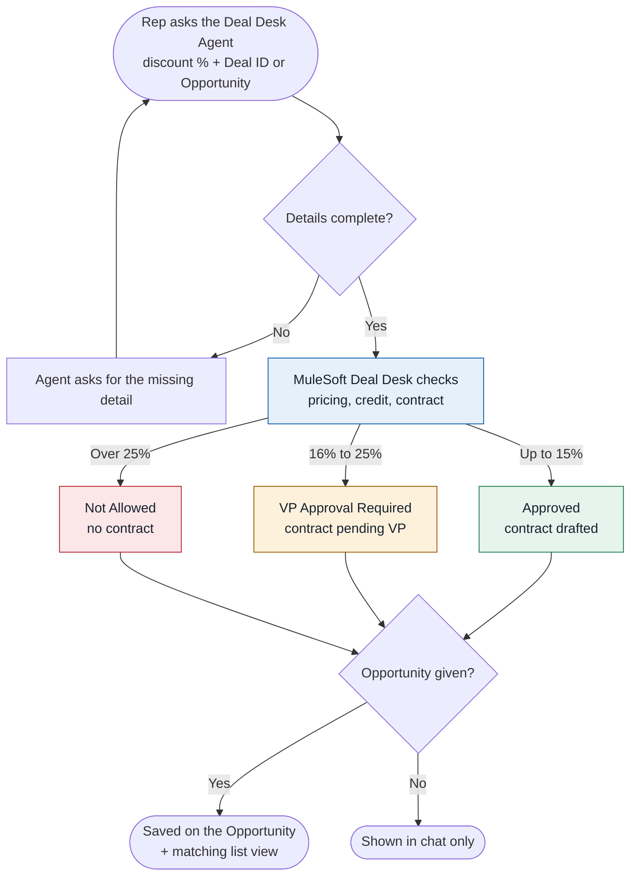

The bands are the company discount policy, which lives in the Pricing Agent:
- Reps can give up to 15% directly.
- A VP can approve up to 25%.
- Anything above 25% is not allowed.

The bands apply to every deal. The margin shown in the reply is for information only. A live check on ACME-Q4 on 26 Nov 2026 matched the bands: 15% approved, 16–25% VP approval, 26% not allowed.

## How the pieces connect

Everything in the Deal Desk app is ordinary Salesforce metadata from this project. The only external system is the Agent Fabric broker, which makes the pricing, credit and contract decision.

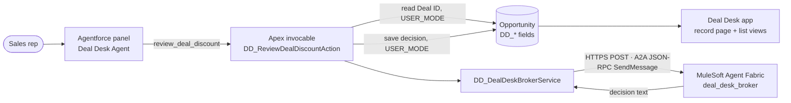

| Layer | What it is |
|---|---|
| **Agent** | `DD_Deal_Desk_Agent`: an Agent Script employee agent, published and active as v1. It has one action, `review_deal_discount` |
| **Logic** | Apex: `DD_ReviewDealDiscountAction` (the invocable action) and `DD_DealDeskBrokerService` (the callout and reply parsing). Apex tests: 19/19 passing, about 97% coverage on both classes |
| **Data and UI** | 5 Opportunity fields, the `DD_Deal_Desk` app, the Deal Desk Opportunity record page and 5 list views |
| **Access** | Permission set `DD_Deal_Desk_User` grants the app, the agent, the Apex class and edit access to the fields. Remote site `DD_Agent_Fabric_Broker` allows the callout |

## Before you start

| Check | Why it matters |
|---|---|
| Your user has the permission set `DD_Deal_Desk_User` | Without it you see neither the app nor the agent, and the action cannot read or save the Deal Desk fields |
| A test Opportunity exists with Deal ID `ACME-Q4` | The agent can take the Deal ID from the Opportunity, and the broker knows deal ACME-Q4 (Acme Retail, ₹50,00,000) |
| Agent `DD_Deal_Desk_Agent` is active | Users can only chat with a published and activated agent version |
| Hard-refresh Salesforce once (Cmd+Shift+R or Ctrl+Shift+R) | The browser caches the App Launcher and the agent list after access changes |
| Open `https://deal-desk-agents.onrender.com/health` first | The mock agents sleep when idle, and the first call can take up to a minute |

---

## Phase A: App, list view and record page

### Step 1: Find the Deal Desk app

**Do:** Click the App Launcher (9 dots) and type `Deal Desk`.

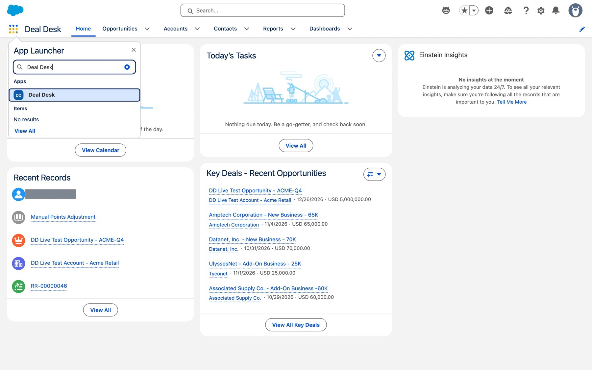

**Expected:** The **Deal Desk** app appears under Apps.

> **Why this happens**
> - `applications/DD_Deal_Desk.app-meta.xml` defines a Lightning app labelled "Deal Desk".
> - The app is visible only to users whose permission set grants it:
>
> ```xml
> <!-- permissionsets/DD_Deal_Desk_User.permissionset-meta.xml -->
> <applicationVisibilities>
>     <application>DD_Deal_Desk</application>
>     <visible>true</visible>
> </applicationVisibilities>
> ```

### Step 2: Open the app

**Do:** Click **Deal Desk**.

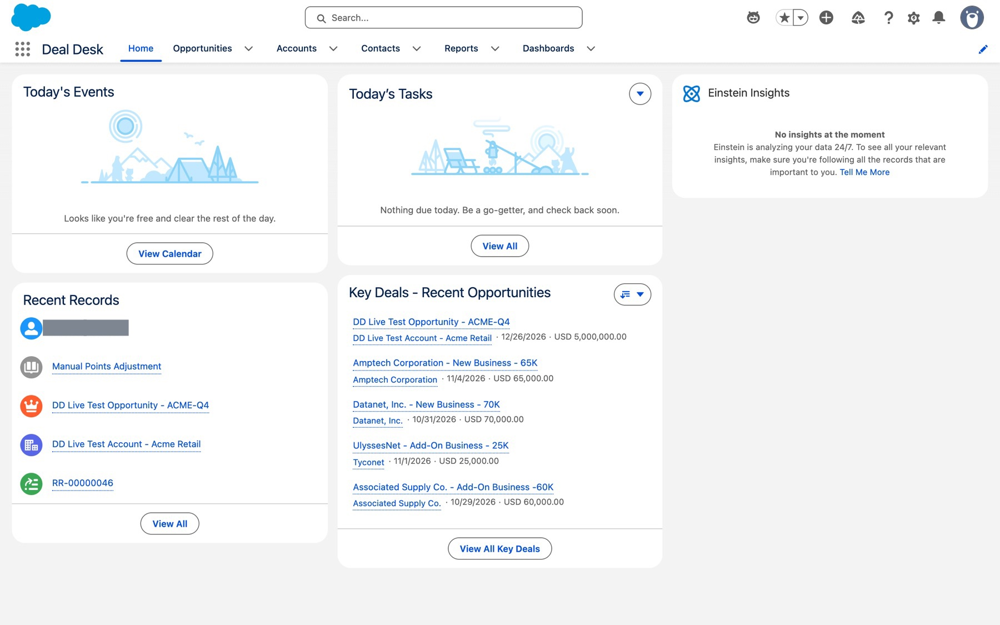

**Expected:** The header shows "Deal Desk" with the tabs Home, Opportunities, Accounts, Contacts, Reports and Dashboards.

> **Why this happens**
> - The app uses standard navigation and is set up for desktop.
> - It lists exactly these standard tabs: `standard-home`, `standard-Opportunity`, `standard-Account`, `standard-Contact`, `standard-report`, `standard-Dashboard`.

### Step 3: Open a Deal Desk list view

**Do:** Go to **Opportunities**, open the list view picker and choose **Deal Desk - All Deals**.

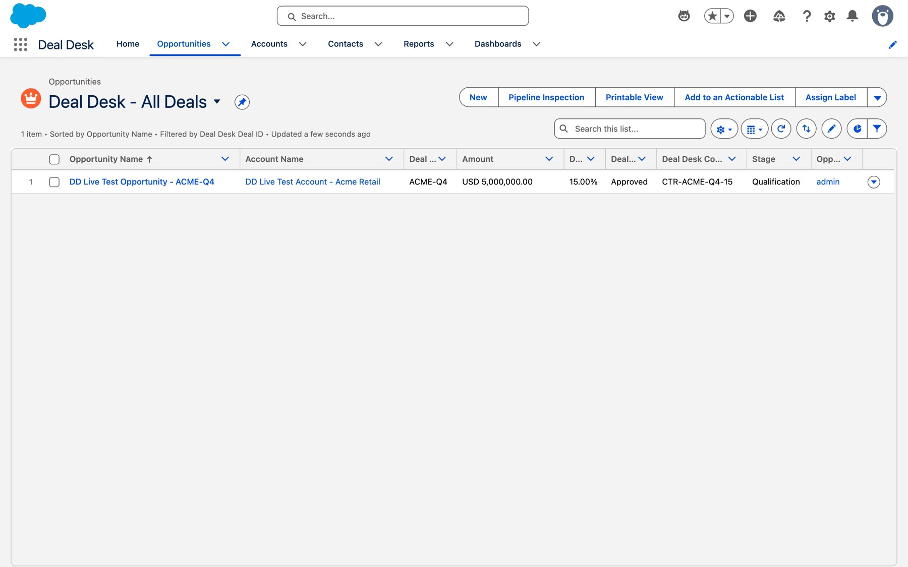

**Expected:** The test Opportunity is listed. The columns are Deal ID, Amount, Requested Discount, Decision, Contract Draft ID, Stage and Owner.

> **Why this happens**
> - `objects/Opportunity/listViews/DD_All_Deal_Desk_Deals.listView-meta.xml` filters on Deal ID not blank and is shared with all users (`filterScope = Everything`).
> - Four more list views filter on the Decision picklist:
>   - Awaiting Review (Deal ID set, no decision)
>   - Approved
>   - VP Approval Needed
>   - Not Allowed

### Step 4: Open the Opportunity record

**Do:** Click **DD Live Test Opportunity - ACME-Q4**.

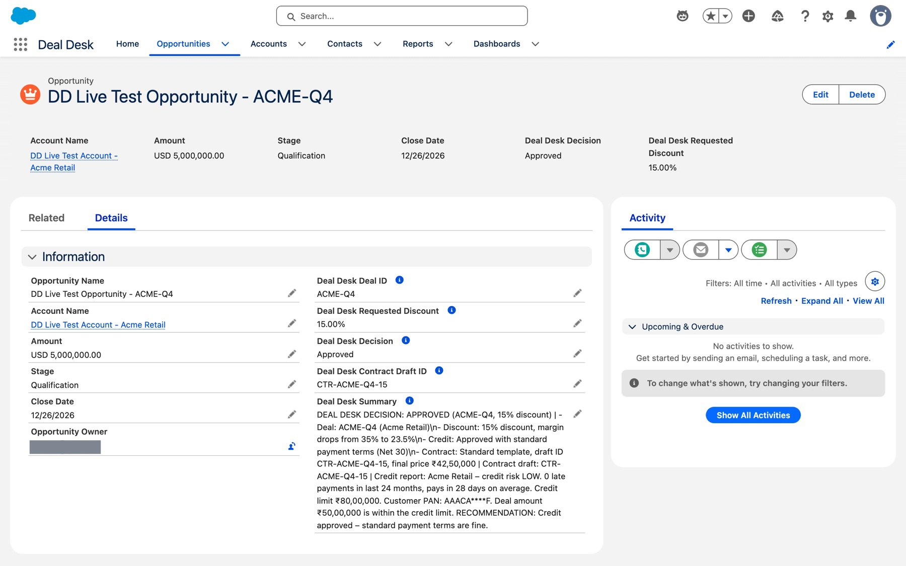

**Expected:**
- The highlights panel shows Account, Amount, Stage, Close Date, **Deal Desk Decision** and **Deal Desk Requested Discount**.
- The Information section shows Deal ID `ACME-Q4`, the Contract Draft ID and the full Deal Desk Summary.

> **Why this happens**
> - `flexipages/DD_Deal_Desk_Opportunity_Record_Page.flexipage-meta.xml` places the Deal Desk fields in the highlights panel and the field section.
> - The app sets this page as the default Opportunity view *inside the Deal Desk app only*. Other apps keep their own Opportunity page:
>
> ```xml
> <actionOverrides>
>     <actionName>View</actionName>
>     <content>DD_Deal_Desk_Opportunity_Record_Page</content>
>     <formFactor>Large</formFactor>
>     <type>Flexipage</type>
>     <pageOrSobjectType>Opportunity</pageOrSobjectType>
> </actionOverrides>
> ```
>
> - The fields are visible and editable because the permission set grants read/edit field-level security on all five `DD_*` fields.

---

## Phase B: Agent conversations with a deal ID only

In this phase no Opportunity is given. The agent only reports decisions, and no record changes.

### Step 5: Open the Deal Desk Agent

**Do:** Click the **Agentforce** icon in the header. If an agent picker appears, choose **Deal Desk Agent**.

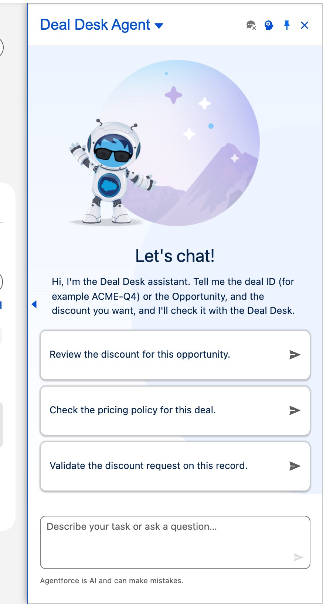

**Expected:** The panel title reads **Deal Desk Agent** and shows the Deal Desk welcome message.

> **Why this happens**
> - The agent is an `AgentforceEmployeeAgent`. It is published and active (v1), and employee agents open in the Agentforce panel.
> - The permission set grants access to it:
>
> ```xml
> <agentAccesses>
>     <agentName>DD_Deal_Desk_Agent</agentName>
>     <enabled>true</enabled>
> </agentAccesses>
> ```
>
> - The welcome text comes from `system.messages.welcome` in `aiAuthoringBundles/DD_Deal_Desk_Agent/DD_Deal_Desk_Agent.agent`.
> - The Agentforce panel is global, so users can open the agent in every app. The permission set is the only thing that controls access.

### Step 6: Missing information

**Send:** `Check a 15% discount`

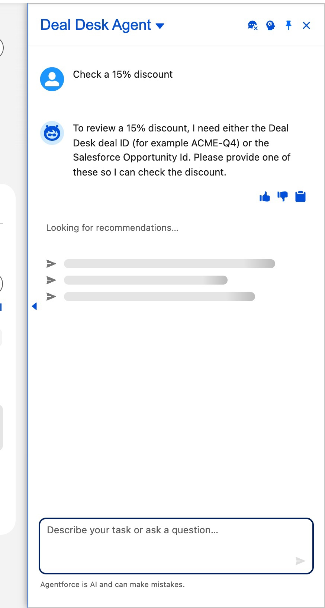

**Expected:** The agent asks for the Deal ID or the Opportunity Id. It does not call the broker.

> *"To review a 15% discount, I need either the Deal Desk deal ID (for example ACME-Q4) or the Salesforce Opportunity Id…"*

> **Why this happens**
> - The agent's reasoning instructions say to use `review_deal_discount` once it has the discount percent *and* either a deal ID or an Opportunity Id. If either is missing, it asks one short question.
> - In the action definition, `discountPercent` is required, while `dealId` and `opportunityId` are optional. The model therefore has to collect at least one of them.

### Step 7: Approved, using a deal ID

**Send:** `Review a 10% discount on deal ACME-Q4`

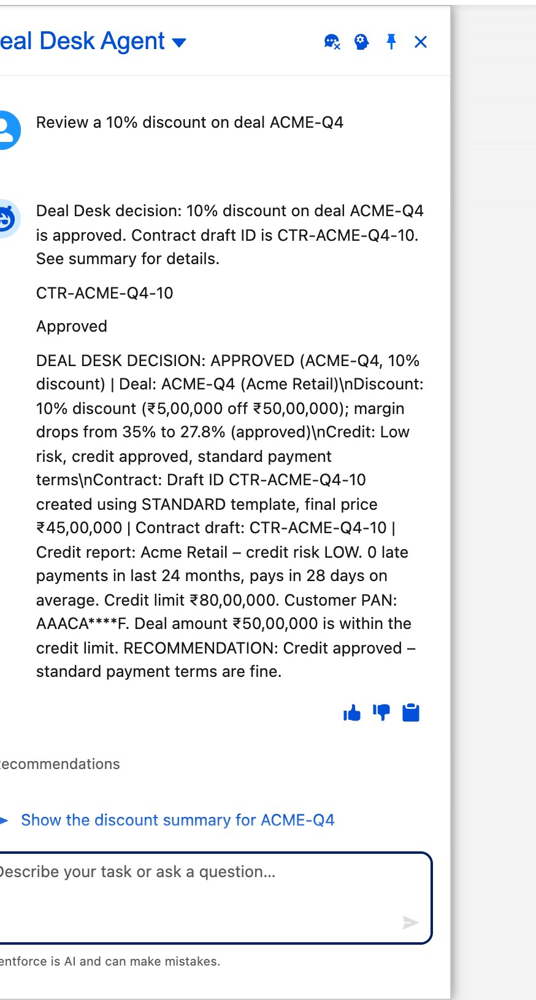

**Expected:**
- Decision **Approved**, contract draft `CTR-ACME-Q4-10`.
- While it runs, the panel shows "Checking with the Deal Desk…".
- No record changes, because no Opportunity was given.

> *"Deal Desk decision: 10% discount on deal ACME-Q4 is approved. Contract draft ID is CTR-ACME-Q4-10."*

> **Why this happens**
> - The action targets `apex://DD_ReviewDealDiscountAction`. It passes `dealId=ACME-Q4` and `discountPercent=10` to `DD_DealDeskBrokerService.reviewDeal`.
> - The service POSTs an A2A v1.0 JSON-RPC `SendMessage` request to the broker endpoint `…/deal_desk_broker/`, with a 120 s timeout. Remote site `DD_Agent_Fabric_Broker` allows the callout.
> - The Pricing Agent approves 10% because it is within the 15% rep limit. The reply also reports that margin drops from 35% to 27.8%, for information only.
> - The service reads "DEAL DESK DECISION: APPROVED" from the reply and extracts the contract ID with the pattern `CTR-[A-Z0-9-]+`.
> - "Checking with the Deal Desk…" comes from `progress_indicator_message` on the action.
> - Nothing is saved, because the save step runs only when an `opportunityId` is present.

### Step 8: Not Allowed

**Send:** `Check 30% on GLOBEX-Q4`

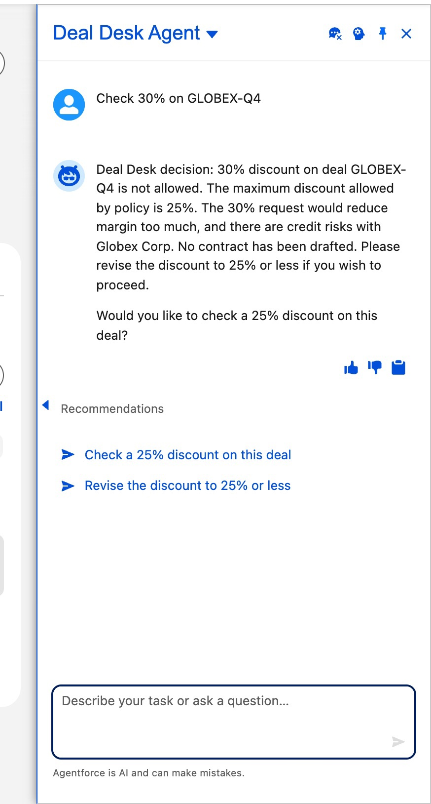

**Expected:** Decision **Not Allowed**, maximum allowed 25%, no contract drafted.

> *"…30% discount on deal GLOBEX-Q4 is not allowed. The maximum discount allowed by policy is 25%… No contract has been drafted."*

> **Why this happens**
> - The pricing policy rejects any discount over 25%, whatever the deal or margin.
> - Globex is also flagged as a high credit risk, but that only affects payment terms.
> - Because pricing said Not Allowed, the broker skips the Contract Agent.
> - The service maps "DEAL DESK DECISION: NOT ALLOWED" to the decision `Not Allowed` and leaves `contractDraftId` empty.
> - The agent's instruction for Not Allowed says to give the reason and the highest discount the summary allows.

### Step 9: Off-topic request

**Send:** `What's the weather in Delhi today?`

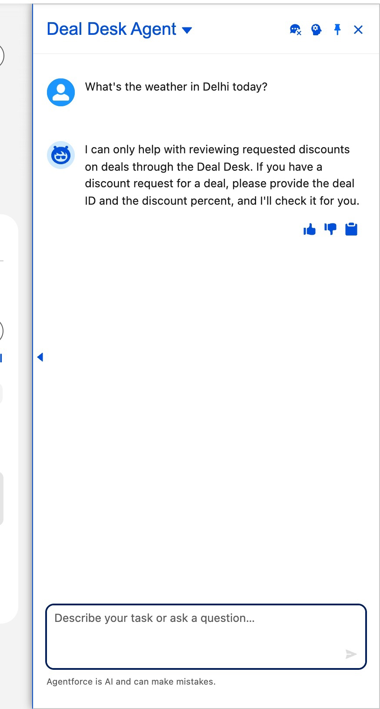

**Expected:** The agent declines and steers back to deal discount reviews. It does not call the action.

> *"I can only help with reviewing requested discounts on deals through the Deal Desk…"*

> **Why this happens**
> - The system instructions limit the agent to deal discount reviews and tell it to redirect other requests.
> - The reasoning block repeats this: "If the request is not about a deal discount review, briefly say what you can help with."
> - The agent has one execution block and one action, so it has nothing else it could do.

---

## Phase C: Agent saves the decision on the Opportunity

The Opportunity Id is in the record URL (`006…`). In this phase the agent reads the Deal ID from the record and writes the decision back to it.

### Step 10: VP approval, using the Opportunity

**Send (on the Opportunity page):** `Now check 20% for Opportunity <Opportunity Id>`

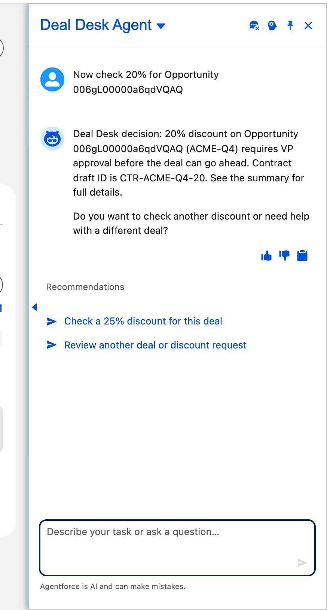

**Expected:** Decision **VP Approval Required**, contract draft `CTR-ACME-Q4-20`. The agent says VP approval is needed.

> **Why this happens**
> - The agent passes the Id as `opportunityId`. The input is typed `object` with `lightning__recordIdType` to match the Apex `Id` field. A plain string fails live validation.
> - No deal ID was given, so the Apex reads `DD_Deal_ID__c` from the Opportunity `WITH USER_MODE` and gets `ACME-Q4`.
> - 20% is above the 15% rep limit but within the 25% VP limit, so it needs VP sign-off. The reply notes that margin drops to 18.8%.
> - The Contract Agent uses the extended (3-year) template for discounts over 15%.
> - The agent's instruction for VP Approval Required says that VP approval is needed and gives the contract draft ID. It does not claim that the agent can request VP approval itself.

### Step 11: Decision saved on the record

**Do:** Refresh the Opportunity page.

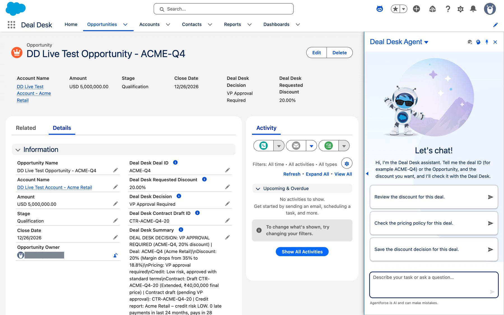

**Expected:**
- Decision = **VP Approval Required**
- Requested Discount = **20%**
- Contract Draft ID = `CTR-ACME-Q4-20`
- The Summary holds the broker's full reply, with the PAN masked.

> **Why this happens**
> When a review succeeds and an Opportunity is given, `DD_ReviewDealDiscountAction` writes the decision back to that record:
>
> ```apex
> new Opportunity(
>     Id = req.opportunityId,
>     DD_Decision__c = res.decision,
>     DD_Requested_Discount__c = req.discountPercent,
>     DD_Contract_Draft_Id__c = res.contractDraftId,
>     DD_Deal_Desk_Summary__c = res.summary
> );
> Database.update(opportunitiesToUpdate, false, AccessLevel.USER_MODE);
> ```
>
> - The update runs in `USER_MODE`. It succeeds only because the permission set gives the rep edit access to these fields and to Opportunity.
> - The Agent Fabric gateway masks the PAN before the reply reaches Salesforce.

### Step 12: Record moves to the VP list view

**Do:** Open the list view **Deal Desk - VP Approval Needed**.

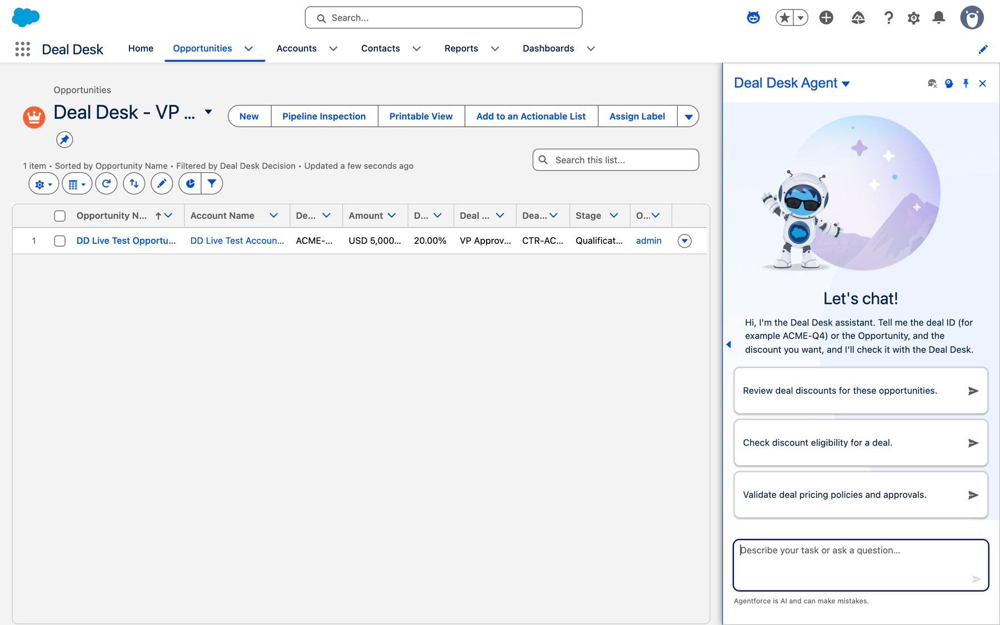

**Expected:** The test Opportunity is listed with Decision = VP Approval Required.

> **Why this happens:** `DD_VP_Approval_Required.listView-meta.xml` filters on `DD_Decision__c equals "VP Approval Required"`. The agent's save changed that field, so the record now matches.

### Step 13: Approved, using the Opportunity

**Send:** `Review a 10% discount for Opportunity <Opportunity Id>`

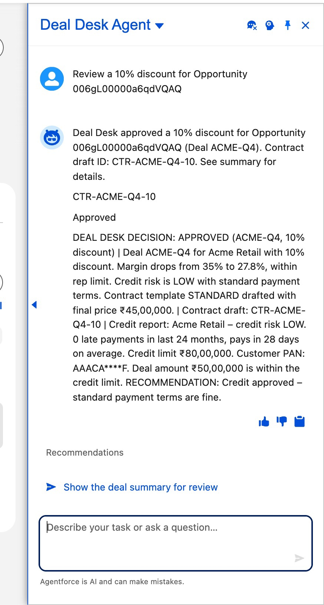

**Expected:** Decision **Approved**, contract draft `CTR-ACME-Q4-10`.

> **Why this happens:**
> - This is the same path as step 10 with a lower discount.
> - 10% is within the 15% rep limit, so it is approved.
> - The action overwrites the earlier decision on the record.

### Step 14: Record shows the new decision

**Do:** Refresh the Opportunity page.

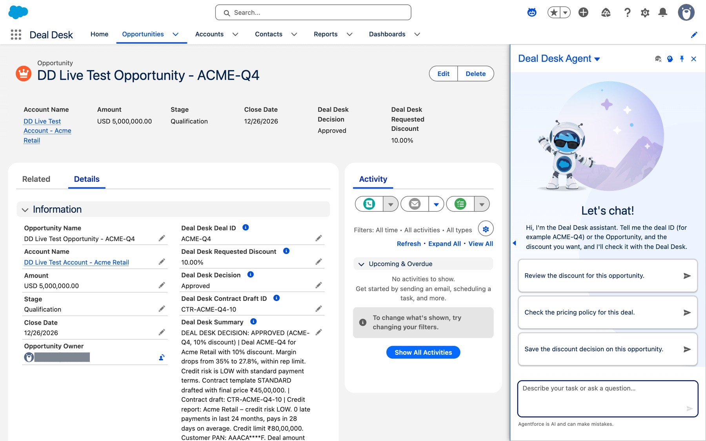

**Expected:** Decision = **Approved**, Requested Discount = **10%**, Contract Draft ID = `CTR-ACME-Q4-10`.

> **Why this happens:** The save logic is the same as in step 11. Every successful review replaces all four Deal Desk values, so the record always shows the latest decision.

### Step 15: Record moves to the Approved list view

**Do:** Open the list view **Deal Desk - Approved**.


**Expected:** The test Opportunity is listed with Decision = Approved and 10.00%. It is no longer in VP Approval Needed.

> **Why this happens:** `DD_Approved.listView-meta.xml` filters on `DD_Decision__c equals "Approved"`.

---

## Results

| Step | Scenario | Decision | Record change | Status |
|---|---|---|---|---|
| 1–4 | App, list view, record page | n/a | None | ✅ PASS |
| 5 | Agent opens with the welcome message | n/a | None | ✅ PASS |
| 6 | Missing deal ID | Asks a question | None | ✅ PASS |
| 7 | 10% on ACME-Q4 (deal ID) | 🟢 Approved | None | ✅ PASS |
| 8 | 30% on GLOBEX-Q4 (deal ID) | 🔴 Not Allowed | None | ✅ PASS |
| 9 | Off-topic | Redirect | None | ✅ PASS |
| 10–12 | 20% on Opportunity | 🟠 VP Approval Required | Saved, moved to the VP list view | ✅ PASS |
| 13–15 | 10% on Opportunity | 🟢 Approved | Saved, moved to the Approved list view | ✅ PASS |

At the end of this run the test record is **Approved, 10%, CTR-ACME-Q4-10**. To demo the VP path again, repeat step 10.

## Troubleshooting

| What you see | Likely cause | Fix |
|---|---|---|
| The Deal Desk app or agent is missing | The logged-in user does not have `DD_Deal_Desk_User`, or the browser cache is stale | Assign the permission set to that exact user, then hard-refresh or log in again |
| The agent says to ask the admin for `DD_Deal_Desk_User` (`OPPORTUNITY_NOT_ACCESSIBLE`) | The user cannot read the Deal Desk fields, so the action's USER_MODE query is blocked | Assign the permission set |
| The agent says the Opportunity was not found or is not shared | Wrong Id, a deleted record, or a record not shared with the user | Check the Id in the URL and the record's sharing |
| "Decision returned, but it was not saved on the Opportunity" | The decision came back, but the user cannot edit that Opportunity | Give the user edit access to the record |
| "Could not reach the Deal Desk broker" | The Agent Fabric broker or gateway is down, or the remote site is inactive | Check the broker, and confirm that remote site `DD_Agent_Fabric_Broker` is active |
| "The Deal Desk language model is busy" | Gemini free-tier rate limit | Wait about 60 seconds and ask again |
| A long wait on the first request | The Render mock agents were asleep | Open the `/health` URL before the demo |
| The record did not change after the agent replied | The page shows cached values | Refresh the record page |

## Build inventory

All components are in this repo, and [`manifest/package.xml`](../../manifest/package.xml) lists them. API version 66.0.

| Type | Component | Role in the flow |
|---|---|---|
| AiAuthoringBundle | `DD_Deal_Desk_Agent` | Agent Script source: instructions, the `review_deal_discount` action, welcome and error messages |
| Bot / BotVersion / GenAiPlannerBundle | `DD_Deal_Desk_Agent` v1 | Runtime agent created by publish (Active) |
| ApexClass | `DD_ReviewDealDiscountAction` | Invocable action: works out the Deal ID, calls the service, saves the decision, handles access errors |
| ApexClass | `DD_DealDeskBrokerService` | A2A JSON-RPC callout to the broker; parses the decision and contract ID |
| ApexClass (tests) | `DD_DealDeskBrokerServiceTest`, `DD_ReviewDealDiscountActionTest`, `DD_DealDeskBrokerMock`, `DD_TestDataFactory` | 19 tests, run as a Standard User with and without the permission set; about 97% coverage |
| CustomField (Opportunity) | `DD_Deal_ID__c`, `DD_Requested_Discount__c`, `DD_Decision__c`, `DD_Contract_Draft_Id__c`, `DD_Deal_Desk_Summary__c` | Where the decision is stored. Decision is a restricted picklist |
| CustomApplication | `DD_Deal_Desk` | The Deal Desk app, with an app-level Opportunity page override |
| FlexiPage | `DD_Deal_Desk_Opportunity_Record_Page` | Opportunity page with the Deal Desk fields |
| ListView (Opportunity) | `DD_All_Deal_Desk_Deals`, `DD_Awaiting_Review`, `DD_Approved`, `DD_VP_Approval_Required`, `DD_Not_Allowed` | Queues by decision |
| PermissionSet | `DD_Deal_Desk_User` | App, agent, Apex class and field access |
| RemoteSiteSetting | `DD_Agent_Fabric_Broker` | Allows the callout to the Agent Fabric gateway |

**Source code:**
- [deal-desk-salesforce](https://github.com/deepshikhalmp-dot/deal-desk-salesforce): this repo
- [deal-desk-network](https://github.com/deepshikhalmp-dot/deal-desk-network): Agent Fabric broker
- [deal-desk-agents](https://github.com/deepshikhalmp-dot/deal-desk-agents): mock Pricing, Credit and Contract agents

---

*The screenshots were captured on 26 Nov 2026 in the demo org, using an admin user with `DD_Deal_Desk_User` in desktop Chrome at 1440×900. User names are redacted. The agent replies are the live replies from that run. The broker's wording can vary slightly between runs, but the decision and the contract ID stay the same for the same input.*
